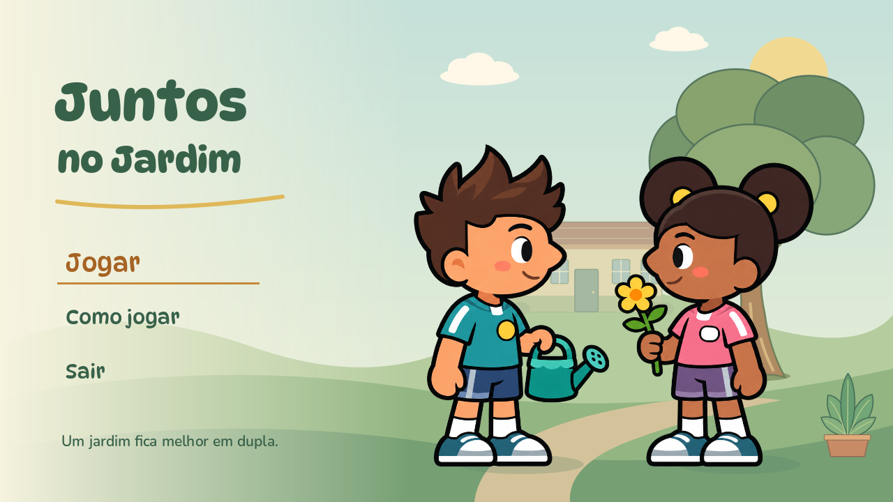
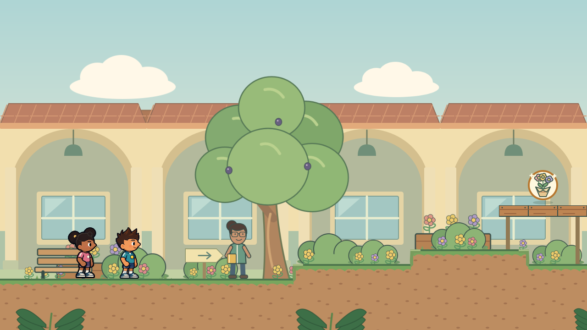

# Juntos no Jardim

Jogo de plataforma 2D **cooperativo para dois jogadores**, feito em **Godot 4**. Ana e João precisam preparar o jardim da escola antes da chegada da turma, e só avançam de fase se chegarem juntos ao fim.



## Como funciona

- **3 fases:** Galeria, Estufa e Bosque, com tempo limite de 40, 45 e 50 segundos
- **Tarefas em dupla:** colher flores, pegar o regador, plantar e regar
- **Obstáculos:** galhos, pássaros e poças; cada toque tira uma vida
- **Vidas compartilhadas:** perto do colega, um jogador pode doar uma vida para o outro
- **Professora** com diálogos no início e no encerramento
- Menu, tela "Como jogar", pause, game over e tela final



## Controles

| Ação | Ana (jogador 1) | João (jogador 2) |
| --- | --- | --- |
| Andar | A / D | ← / → |
| Pular | W ou Espaço | ↑ |
| Interagir / doar vida | E | Shift |
| Pausar | Esc | Esc |

## Estrutura

```
Cenas/          menu, pausa, fim, game over, diálogo e as 3 fases
  Cenarios/     01_galeria, 02_estufa, 03_bosque
  Personagens/  Ana, João, professora e colegas
Scripts/        lógica em GDScript (personagem, fases, perigos, diálogo, pausa)
Assets/         sprites, cenários, sons, músicas e fontes (licenças incluídas)
Documentacao/   capturas e registros de testes
```

## Como jogar

1. Instale o [Godot 4](https://godotengine.org/download) (versão 4.7 ou mais nova)
2. Clone o repositório e abra o arquivo `project.godot` no Godot
3. Aperte **F5**

## Próximos passos

- Controle físico com **ESP32** para os dois jogadores
- Teste de usabilidade com crianças

## Equipe

Projeto em grupo. Participação de **Miguel Henriques Coelho** ([GitHub](https://github.com/miguelhenricoelho)).

Fontes: DynaPuff, Nunito e DejaVu Sans, sob as licenças incluídas em `Assets/Fontes`.
